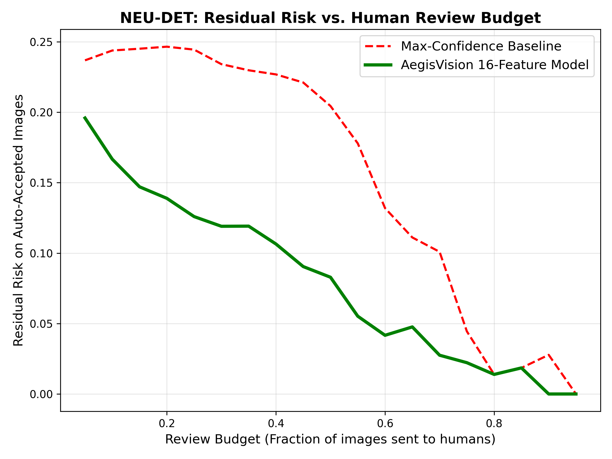
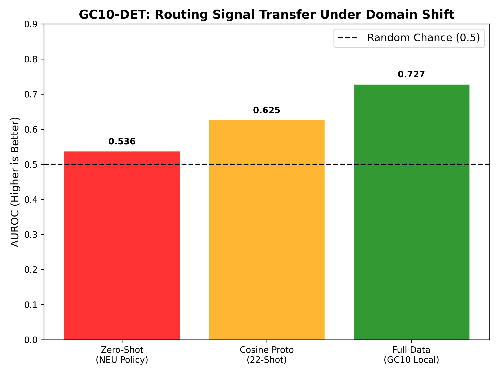
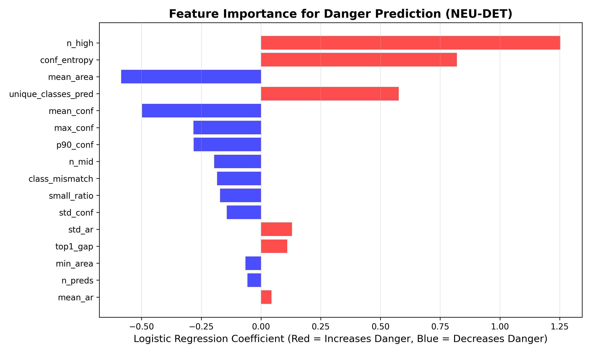

# 🛡️ AegisVision: Confidence-Aware Human-in-the-Loop Defect Inspection

<div align="center">
  
  ### 🚀 [Click Here to Try the Live Interactive Demo](https://aegisvision-n84itsqjrquzfpkwu5x3d9.streamlit.app/)
  
</div>

---


**AegisVision** is a training-free, post-hoc routing framework for industrial steel surface defect detection. It aims to answer a critical safety question: *"When should a human inspector trust the AI, and when should they be asked to review?"*

Built with PyTorch, YOLO11s, and Scikit-Learn. Fully reproducible.

---

## 📊 The Core Findings (What we proved)

1. **Same-Domain Success:** On the NEU-DET dataset, our 16-feature Logistic Regression routing policy achieved an OOF AUROC of **0.821**. At a 20% human review budget, it reduced residual risk by **51%** compared to standard max-confidence routing.
2. **Cross-Domain Failure:** When tested zero-shot on the GC10-DET dataset (severe resolution and texture shift), the policy failed (AUROC **0.536**). Deep YOLO semantic embeddings also failed.
3. **The Calibration Limit:** Through Transductive Conformal Prediction, we mathematically demonstrated that **22 images are insufficient** to guarantee a 10% risk bound under this domain shift. A minimum of 90+ target images is required for statistical safety.

---

## 📈 Visual Evidence

### 1. The Success: Risk-Coverage on NEU-DET
By routing high-entropy predictions to humans, we drastically reduce the risk of missed defects on the auto-accepted set.


### 2. The Reality of Domain Shift (GC10-DET)
Zero-shot transfer fails. However, using a simple Cosine Prototype with just 22 target images recovers a significant portion of the signal.


### 3. Why it works: Feature Importance
The model relies heavily on **prediction density (`n_high`)** and **confidence entropy**, rather than raw max-confidence.


---

## ⚙️ Reproducibility (The "Safe Loop")

This project strictly follows a Safe Drive Persistence and bit-identical reproducibility protocol.
To reproduce our validation metrics from a fresh clone:

```bash
git clone https://github.com/maashg3l4/aegisvision.git
cd aegisvision
pip install -r requirements.txt

# 1. Extract predictions and GT
python src/evaluation/extract_predictions.py --model best.pt --data data.yaml --out ./out

# 2. Build image-level features
python src/evaluation/build_features.py --preds ./out/predictions.json --gt ./out/instances_val.json --out features.csv
```

*Our audit confirms that a fresh clone produces bit-identical MD5 hashes for the feature CSV.*

---

## 🗺️ Project Structure

- `src/data/`: Dataset conversion (NEU-DET and GC10-DET).
- `src/evaluation/`: Prediction extraction and 16-feature engineering.
- `src/policy/`: Frozen routing policy (Budget-Constrained Ranking).
- `docs/reports/`: Detailed scientific findings (including negative results).
- `assets/`: High-resolution plots for papers and presentations.

## 📜 Citation
*(AegisVision Paper Draft - In Progress, 2026)*
<!-- Verified contribution graph -->
