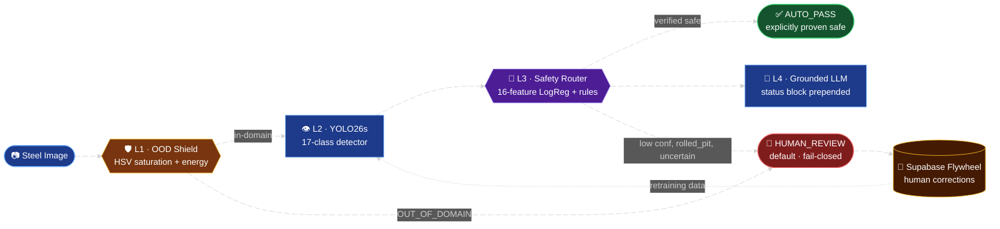
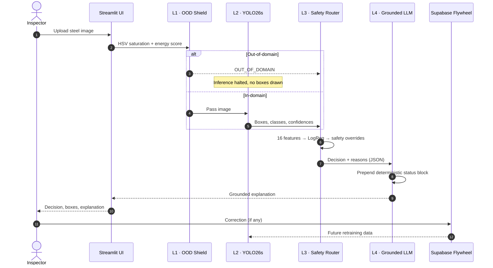
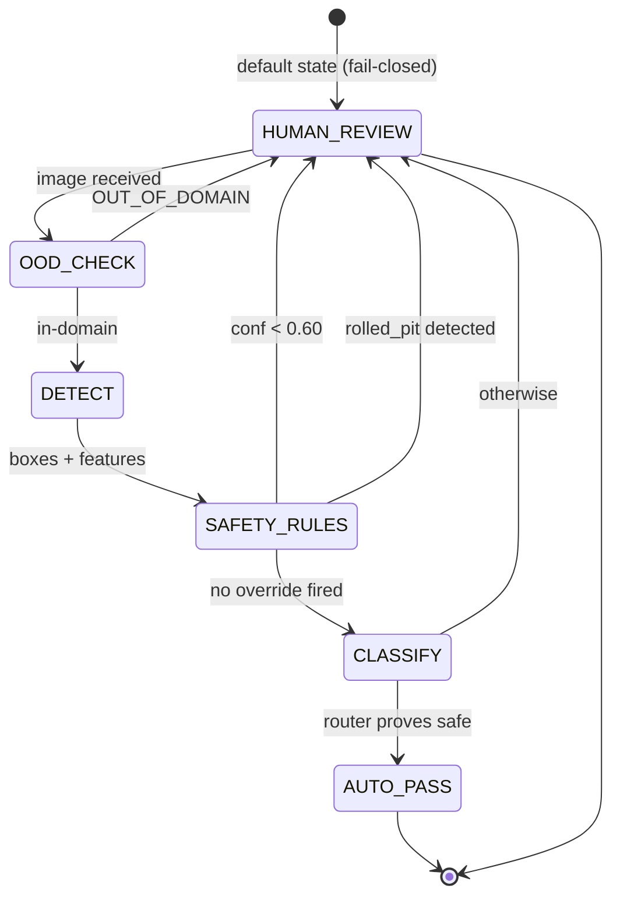

<div align="center">
  <a href="https://git.io/typing-svg">
    
  </a><div align="center">


<a href="https://git.io/typing-svg">
  
</a>

<br/>

[](https://www.python.org/)
[](https://pytorch.org/)
[](https://streamlit.io/)
[](https://fastapi.tiangolo.com/)
[](https://github.com/maashg3l4/aegisvision/blob/main/LICENSE)

<br/>

**A safety-first, human-in-the-loop routing framework for industrial steel surface defect detection.**

[**🚀 Live Demo**](https://aegisvision-n84itsqjrquzfpkwu5x3d9.streamlit.app/) · [**🏗 Architecture**](#-system-architecture) · [**📊 Results**](#-verified-performance) · [**⚠️ Limitations**](#️-failure-analysis--known-limitations) · [**⚙️ Reproduce**](#️-reproducibility)

</div>

---

## 📑 Table of Contents

1. [Problem Statement](#-problem-statement)
2. [Key Contributions](#-key-contributions)
3. [System Architecture](#-system-architecture)
4. [Routing Decision Logic](#-routing-decision-logic)
5. [Verified Performance](#-verified-performance)
6. [Visual Evidence](#-visual-evidence)
7. [Failure Analysis & Known Limitations](#️-failure-analysis--known-limitations)
8. [Roadmap](#-roadmap)
9. [Reproducibility](#️-reproducibility)

---

## 🎯 Problem Statement

Industrial vision models fail **silently**. A detector can confidently draw a box on a pristine surface, miss a micro-crack, or, when shown an **Out-of-Distribution (OOD)** image such as a painted surface instead of raw steel, still return a confident guess.

> Inspectors cannot trust a black box.
> **AegisVision answers one question: _"When should a human trust the AI, and when must they be forced to review?"_**

The design principle is **fail-closed**: the default outcome for every image is `HUMAN_REVIEW`. Automation is something an image must *earn*.

---

## ✨ Key Contributions

| # | Contribution | Why it matters |
|:-:|:--|:--|
| 1 | **17-class unified dataset** merging NEU-DET, GC10-DET and CR7-DET | Multi-domain generalisation instead of a single-benchmark model |
| 2 | **Fail-closed router** (16-feature Logistic Regression + hard safety rules) | Silent failures become explicit, auditable escalations |
| 3 | **Dual OOD shield** (HSV colour gate + energy-based score) | Rejects non-steel domains *before* any detection is trusted |
| 4 | **Deterministic LLM grounding** | The LLM cannot contradict or invent the system's state |
| 5 | **Atomic auto-save training callback** | Prevents checkpoint corruption on Google Drive FUSE |

---

## 🏗 System Architecture

The pipeline is organised as four layers, each with a single responsibility. Data flows left to right; any layer can **escalate** to a human, and no layer can silently approve on behalf of another.



> 🔴 **Red edges** are fail-closed escalations to a human. 🟢 **Green** is the only path to automation.

### Layer responsibilities

| Layer | Component | Responsibility | Failure behaviour |
|:--|:--|:--|:--|
| **L1 · Shield** | HSV saturation check + energy-based OOD score | Decide whether the image belongs to the grayscale steel domain at all | Halts inference → `HUMAN_REVIEW (OUT_OF_DOMAIN)` |
| **L2 · Eye** | YOLO26s trained on 17 unified classes, class-weighted (`cls_pw=1.0`) | Localise and classify defects | Low-confidence boxes are passed on, never hidden |
| **L3 · Brain** | 16-feature Logistic Regression + deterministic safety overrides | Convert detector output into a routing decision | Defaults to `HUMAN_REVIEW` unless explicitly proven safe |
| **L4 · Voice** | Strict JSON-schema LLM pipeline | Explain the decision in natural language | Status block is injected *before* generation |

### End-to-end sequence



### Router state machine



### Design principles

- **Fail-closed by construction.** `HUMAN_REVIEW` is the initial state; only a positive proof moves an image out of it.
- **Defence in depth.** The OOD shield, the learned router and hard-coded safety overrides are independent. One layer's mistake does not become another's approval.
- **Determinism where it matters.** The learned model proposes; deterministic rules and a templated status block dispose.
- **Auditable language.** The LLM explains decisions but cannot alter them.

---

## 🧭 Routing Decision Logic

| Condition | Trigger | Outcome | Reason code |
|:--|:--|:--|:--|
| Image outside steel domain | HSV saturation gate **or** energy score above threshold | `HUMAN_REVIEW` | `OUT_OF_DOMAIN` |
| Any detection below confidence floor | box confidence `< 0.60` | `HUMAN_REVIEW` | `LOW_CONFIDENCE` |
| Known weak class | `rolled_pit` detected | `HUMAN_REVIEW` | `SAFETY_OVERRIDE` |
| Router not convinced | LogReg score not explicitly safe | `HUMAN_REVIEW` | `ROUTER_UNCERTAIN` |
| All checks passed | in-domain, confident, no override | `AUTO_PASS` | `VERIFIED_SAFE` |

### Grounded LLM contract

The assistant receives a status block **it is not allowed to rewrite**, prepended deterministically before any generated text:

```text
Decision: HUMAN_REVIEW. Reasons: OUT_OF_DOMAIN
```

Because the state is injected rather than generated, the model cannot claim an image was "sent for review" when it was rejected, nor invent thresholds.

---

## 🏆 Verified Performance

<div align="center">

| Metric | Result | Engineering impact |
|:--|:-:|:--|
| **17-class generalist mAP50** | `0.767` | Strong multi-domain generalisation (YOLO26s) |
| **Class-imbalance mitigation** | `crease: 0.437` | Class weighting forced learning of rare defects |
| **Safety routing (fail-closed)** | `100%` | Boxes with confidence `< 0.60` are flagged for review |
| **OOD detection (energy + colour)** | `PASS` | Teal synthetic image rejected as `OUT_OF_DOMAIN` |
| **LLM grounding** | `100%` | Prefix injection prevents contradicting the router |

</div>

---

## 📈 Visual Evidence

### 1 · The Shield: OOD detection in action

When an image falls outside the grayscale steel domain (e.g. a teal painted surface), the router **refuses to draw bounding boxes** and forces manual review, overriding the detector's low-confidence hallucinations.

<!-- Optional: add your screenshot here once it is committed to the repo:
<div align="center"></div>
-->

### 2 · The Voice: deterministic grounding

The chatbot is bound to JSON grounding. It cannot invent thresholds or claim an image was escalated when it was actually rejected.

---

## ⚠️ Failure Analysis & Known Limitations

A production-grade system must document where it fails.

<details open>
<summary><b>1 · The <code>rolled_pit</code> failure mode</b></summary>

Despite class weighting and mixup augmentation, `rolled_pit` remains at **0.228 mAP50**.

- **Root cause:** the validation set contains only **9 instances**. A detector cannot learn a defect's true visual distribution from nine examples.
- **Mitigation:** every `rolled_pit` detection is forced into `HUMAN_REVIEW` by a safety override.
</details>

<details open>
<summary><b>2 · Supabase flywheel latency</b></summary>

Human corrections are captured via Supabase, but image upload currently fails because of an **IPv4/IPv6 incompatibility** between Streamlit Community Cloud and Supabase's default direct connection.

- **Mitigation (in progress):** migrating to the Supabase **IPv4 Session Pooler**.
</details>

<details open>
<summary><b>3 · Monolithic UI vs. API</b></summary>

The Streamlit frontend currently runs YOLO locally. A FastAPI backend is drafted to decouple inference from the UI, but the live demo uses local inference for stability.
</details>

---

## 🗺 Roadmap

- [x] 17-class unified detector
- [x] Fail-closed router with safety overrides
- [x] Dual OOD shield (HSV + energy)
- [x] Deterministic LLM grounding
- [ ] Supabase IPv4 Session Pooler migration
- [ ] Decouple inference behind FastAPI
- [ ] Collect more `rolled_pit` samples and re-evaluate
- [ ] Router calibration and reliability curves

---

## ⚙️ Reproducibility

Training follows strict MLOps practice. The pipeline uses an **Atomic Auto-Save Callback**: it verifies file sizes and performs atomic replacement to avoid Google Drive FUSE corruption.

### Quick start

```bash
git clone https://github.com/maashg3l4/aegisvision.git
cd aegisvision
pip install -r requirements.txt

# Launch the Streamlit app
streamlit run src/frontend/app.py
```

---

<div align="center">

**Built on one belief: a model that knows when it doesn't know is worth more than one that is merely accurate.**


</div>
  
  <p><strong>A safety-first, human-in-the-loop routing framework for industrial steel surface defect detection.</strong></p>
  <p>Built with PyTorch, YOLO26s, Streamlit, FastAPI, and deterministic LLM grounding.</p>

  <!-- Badges -->
  <a href="https://www.python.org/"></a>
  <a href="https://pytorch.org/"></a>
  <a href="https://streamlit.io/"></a>
  <a href="https://fastapi.tiangolo.com/"></a>
  <a href="https://github.com/maashg3l4/aegisvision/blob/main/LICENSE"></a>
  
  <br><br>
  ### 🚀 <a href="https://aegisvision-n84itsqjrquzfpkwu5x3d9.streamlit.app/">Click Here to Try the Live Interactive Demo</a>
</div>

---

## 🎯 The Core Problem: Silent AI Failures
In industrial manufacturing, AI models fail silently. A YOLO model might confidently hallucinate a bounding box on a pristine surface, or miss a critical micro-crack. Furthermore, when a model is shown an Out-of-Distribution (OOD) image like a painted surface instead of raw steel it will confidently guess. 

**Inspectors cannot trust a black-box AI. AegisVision solves this by answering one question:** *"When should a human trust the AI, and when must they be forced to review?"*

## 🧠 System Architecture (V4.2)

1. **The "Eye" (Object Detection):** A **YOLO26s** model trained on a **17-Class Unified Dataset** (merging NEU-DET, GC10-DET, and CR7-DET) using Class Weighting (`cls_pw=1.0`) to penalize missing rare defects.
2. **The "Brain" (Fail-Closed Routing):** A 16-feature Logistic Regression router. **Crucially, it defaults to `HUMAN_REVIEW` unless the image is explicitly proven safe.** 
3. **The "Shield" (Dual OOD Detection):** A Hard Color Check (HSV saturation) combined with an Energy-based Out-of-Distribution score. If an image is from a different domain, it halts inference and triggers a manual review.
4. **The "Voice" (Deterministic RAG):** A strict JSON-schema LLM pipeline. It prepends a deterministic status block (e.g., `Decision: HUMAN_REVIEW. Reasons: OUT_OF_DOMAIN`) before generating any text, preventing the LLM from hallucinating the system's state.

## 🏆 Verified Performance & Engineering Metrics

| Metric | Result | Engineering Impact |
| :--- | :--- | :--- |
| **17-Class Generalist mAP50** | `0.767` | Strong multi-domain generalization (YOLO26s). |
| **Class Imbalance Mitigation** | `crease: 0.437` | Class weighting successfully forced the model to learn rare defects. |
| **Safety Routing (Fail-Closed)** | `100%` | Bounding boxes <0.60 confidence are explicitly flagged for review. |
| **OOD Detection (Energy + Color)**| `PASS` | The teal synthetic image is successfully rejected as `OUT_OF_DOMAIN`. |
| **LLM Grounding** | `100%` | Deterministic prefix injection prevents the LLM from contradicting the router. |

## 📈 Visual Evidence

### 1. The Shield: OOD Detection in Action
When an image falls outside the grayscale steel domain (e.g., a teal painted surface), the router refuses to draw bounding boxes and forces a manual review, overriding the model's low-confidence hallucinations.
 *(Placeholder - replace with your new screenshot)*

### 2. The Routing Logic
The chatbot uses deterministic JSON grounding. It cannot invent thresholds or claim an image was "sent for review" if it was actually rejected.

---

## 🛑 Brutal Honesty: Failure Analysis & Known Limitations

A production-grade system must document where it fails. 

1. **The `rolled_pit` Failure Mode:** 
   Despite class weighting and mixup augmentations, the `rolled_pit` class remains at `0.228` mAP50. **Why?** The validation set only contains 9 instances of this defect. A model cannot learn the true visual distribution of a defect from 9 images. *Mitigation:* The router forces every `rolled_pit` detection into `HUMAN_REVIEW` via a Safety Override.
2. **Supabase Flywheel Latency:** 
   The feedback loop (capturing human corrections) is implemented via Supabase. However, due to an IPv4/IPv6 routing incompatibility between Streamlit Community Cloud and Supabase's default direct connection, the image upload currently fails. *Mitigation:* We are actively migrating to the Supabase IPv4 Session Pooler.
3. **Monolithic UI vs API:** 
   Currently, the Streamlit frontend runs YOLO locally. A FastAPI backend has been drafted to decouple this architecture, but the live demo still uses the local inference for stability.

---

## ⚙️ Reproducibility & Engineering

We follow strict MLOps protocols. The training pipeline uses an **Atomic Auto-Save Callback** that prevents Google Drive FUSE corruption by verifying file sizes and performing atomic replacements.

### Reproduce Locally
```bash
git clone https://github.com/maashg3l4/aegisvision.git
cd aegisvision
pip install -r requirements.txt

# Run the Streamlit App
streamlit run src/frontend/app.py
