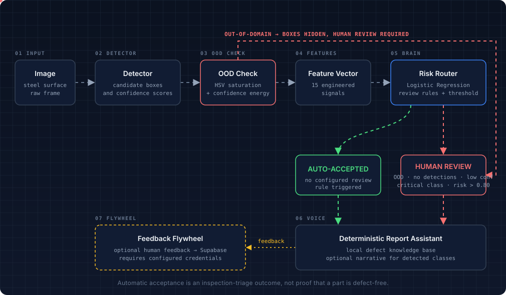
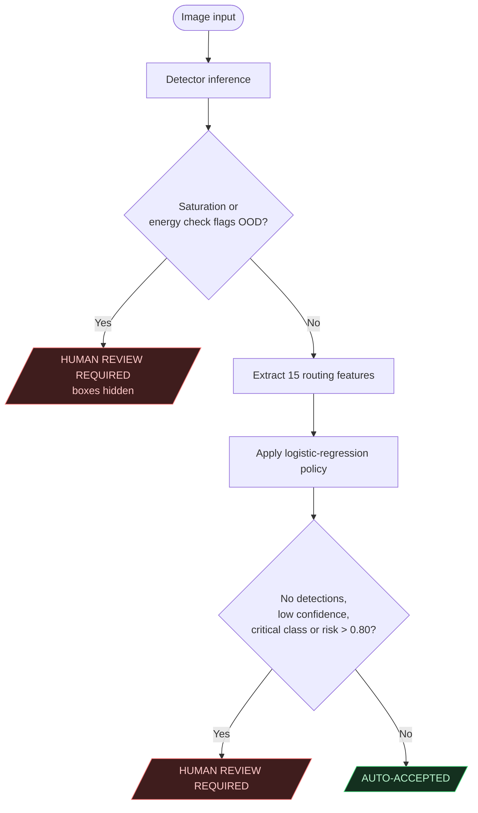
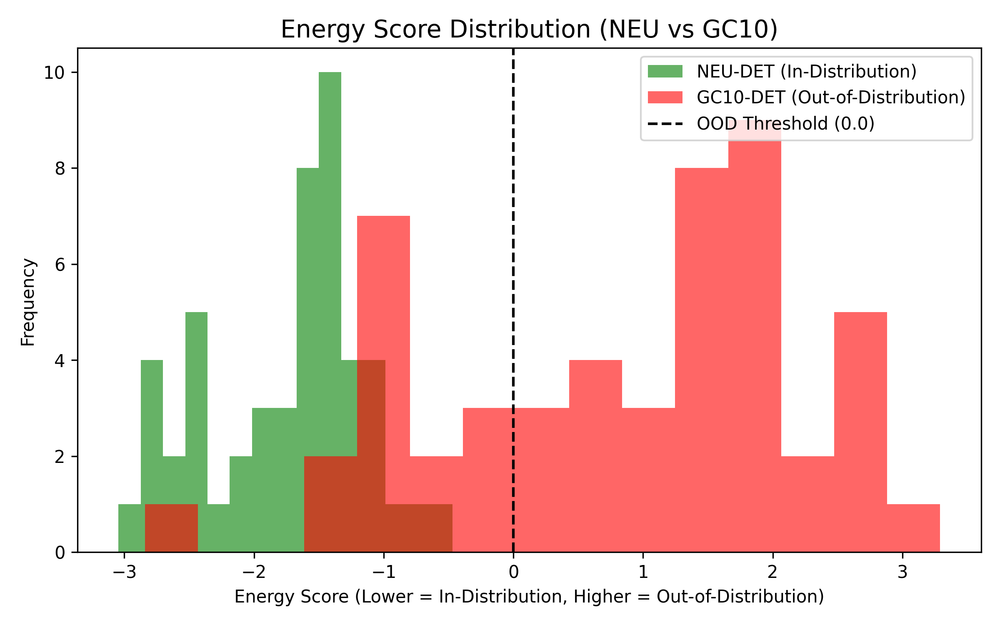

<div align="center">



<br>

<a href="https://www.python.org/"></a>
<a href="https://pytorch.org/"></a>
<a href="https://streamlit.io/"></a>
<br><br>

**A training-free, post-hoc routing framework for industrial steel surface defect detection.**

<br>

[**Live Demo**](https://aegisvision-n84itsqjrquzfpkwu5x3d9.streamlit.app/) ·
[Architecture](#system-architecture) ·
[Results](#recorded-results) ·
[Limitations](#limitations) ·
[Run Locally](#run-locally)

</div>

---

## Overview

Object detectors do not, by themselves, indicate whether their predictions are safe to act on. A confident box may correspond to a defect, a false positive, or an image outside the model's training domain.

AegisVision separates detection from operational decision-making. The Streamlit app runs a detector, extracts 15 routing features, and applies a logistic-regression policy alongside out-of-distribution checks. The current interface reports one of these outcomes:

- **AUTO-ACCEPTED** — no configured review rule was triggered.
- **HUMAN REVIEW REQUIRED** — a configured review rule was triggered, including unfamiliar input.

The system is designed for human-assisted inspection, not autonomous defect clearance. Its status and thresholds describe the current application behavior, not a safety certification.

---

## System Architecture

<div align="center">

</div>

<br>

| Stage | Component | Responsibility |
|:-----:|:----------|:---------------|
| 01 | **Input** | Accept a JPG, JPEG, or PNG image through the Streamlit interface. |
| 02 | **Detector** | Produce candidate boxes and confidence scores for the uploaded image. |
| 03 | **OOD Check** | Check image saturation and a score derived from detector confidences for unfamiliar inputs. This check runs after inference in the current app. |
| 04 | **Feature Extraction** | Convert detections into 15 numerical routing features. |
| 05 | **Routing Policy** | Apply the frozen logistic-regression policy to rank inspection risk. |
| 06 | **Review Rules** | Route unfamiliar images, empty detections, low confidence, configured critical classes, or high risk to human review. |
| 07 | **Report Assistant** | Generate a deterministic report from the local defect knowledge base. |

### Detection and Routing

The dataset unification script defines a 15-class taxonomy combining NEU-DET and GC10-DET:

```text
crazing, inclusion, patches, pitted_surface, rolled-in_scale, scratches,
punching_hole, welding_line, crescent_gap, water_spot, oil_spot,
silk_spot, rolled_pit, crease, waist_folding
```

The V3 routing-policy artifact records a 15-class unified dataset and an AUROC of **0.772**. The app extracts 15 runtime features from prediction confidence, geometry, density, and class diversity and uses a review threshold of **0.80**. The policy artifact and running app should be kept aligned with the listed taxonomy before interpreting results.

In the current implementation:

1. The detector runs before the app evaluates its out-of-distribution signals. If the image is flagged, the app hides the detection boxes and requires manual review.
2. Detection of `crazing`, `rolled-in_scale`, `scratches`, or `crease` forces human review.
3. Empty detections, top-box confidence below `0.60`, or an inspection risk score above `0.80` require human review.
4. Otherwise, the interface marks the image `AUTO-ACCEPTED`.

The app's class-name mapping includes entries outside the dataset taxonomy above. This mismatch needs to be resolved before claiming that runtime detector outputs are validated against the 15-class taxonomy. Routing does not certify that an image is defect-free; it provides inspection triage.

### Decision Flow



---

## Recorded Results

The tracked V3 routing-policy artifact reports the following value. It is not independently reproduced by this README and should not be treated as a guarantee of performance on new materials, cameras, lighting conditions, or production scales.

| Metric | Result | Source |
|:-------|:------:|:-------|
| Routing policy AUROC | **0.772** | `src/policy/routing_policy_v3.json` |

### Visual Evidence

<div align="center">

</div>

---

## Deployment

The application is implemented with Streamlit and loads a detector artifact and routing policy at runtime. The app's runtime class-name mapping is not aligned with the 15-class taxonomy defined by the dataset unification script; verify and resolve that mismatch before deployment or interpreting detector results.

The report assistant uses a local knowledge base to generate deterministic text. The core inspection workflow does not require an API key.

The repository also contains FastAPI and Docker configuration for backend or container-oriented deployment. These components should be evaluated and configured before production use.

---

## Limitations

| Area | Current Limitation |
|:-----|:-------------------|
| **Domain shift** | Performance may degrade under new surfaces, cameras, illumination, or image corruption. |
| **Routing evaluation** | The routing model requires broader prospective validation before production acceptance. |
| **Detection classes** | Rare defect classes may have limited validation support. |
| **Runtime alignment** | The app's class-name mapping includes labels outside the dataset unification taxonomy; detector output alignment is unverified. |
| **Calibration** | Reported routing scores should not be presented as calibrated probabilities without additional validation. |
| **Human review** | The system supports triage; it does not replace trained inspectors or an established quality process. |
| **Feedback** | The feedback integration is optional and should be verified in the target environment. |

---

## Run Locally

```bash
git clone https://github.com/maashg3l4/aegisvision.git
cd aegisvision
python -m pip install -r requirements.txt
streamlit run src/frontend/app.py
```

Python 3.10 or later is listed as the project version target.

---

## Project Structure

```text
src/
├── data/             Dataset preparation and unification
├── evaluation/       Prediction extraction and feature engineering
├── policy/           Routing policy and uncertainty logic
├── frontend/         Streamlit application
├── report_assistant/ Optional report generation
└── api/              FastAPI deployment entry points

assets/               README figures and visual evidence
configs/              Model and benchmark configuration
docs/                 Reports and project documentation
tests/                Test suite
```

---

## Datasets

AegisVision uses the following public defect datasets:

- **NEU-DET** — hot-rolled steel surface defects
- **GC10-DET** — metallic surface defects

Use and redistribution remain subject to the licenses and terms of the original dataset providers.

## Citation

```bibtex
@software{aegisvision2026,
  title  = {AegisVision: A Safety-First Routing Framework for Industrial Steel Surface Defect Detection},
  author = {maashg3l4},
  year   = {2026},
  url    = {https://github.com/maashg3l4/aegisvision}
}
```

## License

No license file is currently present in this repository. Confirm licensing before redistributing this project.
