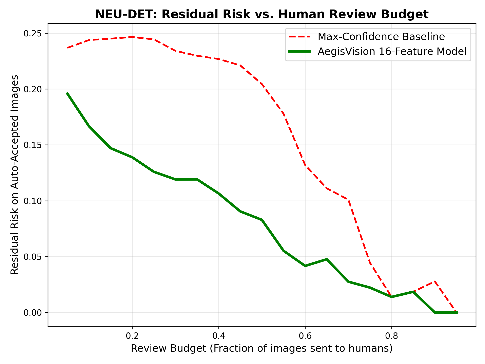
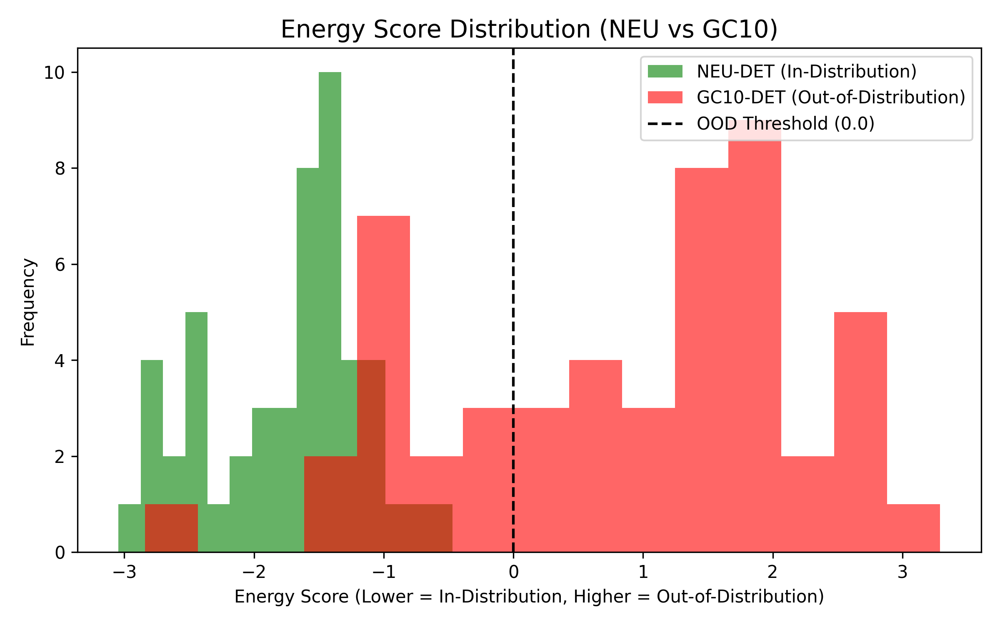

  
  
  
<strong>A training-free, post-hoc routing framework for industrial steel surface defect detection.</strong>

  
Built with PyTorch, YOLO11s, Streamlit, OpenVINO, and custom uncertainty estimation.

  <!-- Badges -->
  
  
  
  
  
    
  ### 🚀 <a href="https://aegisvision-n84itsqjrquzfpkwu5x3d9.streamlit.app/">Click Here to Try the Live Interactive Demo</a>

---

## 🎯 The Core Problem
In industrial manufacturing, AI models fail silently. A YOLO model might confidently draw a bounding box around a non-existent defect (a hallucination) or miss a critical anomaly. **Inspectors cannot trust a black-box AI.** 

**AegisVision solves this by answering one question:** *"When should a human trust the AI, and when must they be asked to review?"*

## 🧠 System Architecture (V3)

1. **The "Eye" (Object Detection):** A YOLO11s model trained on a **15-Class Unified Dataset** (merging NEU-DET and GC10-DET).
2. **The "Brain" (Uncertainty Routing):** A 16-feature Logistic Regression model that analyzes prediction entropy, density, and geometry to calculate a **Risk Score**.
3. **The "Shield" (OOD Detection):** An Energy-based Out-of-Distribution detector that mathematically suppresses hallucinations on foreign images.
4. **The "Voice" (Report Assistant):** A RAG (Retrieval-Augmented Generation) pipeline that generates grounded, metallurgical inspection reports without hallucination.
5. **The "Edge" (Deployment):** Optimized for CPU inference using **OpenVINO INT8 Quantization** for factory-floor latency.

## 🏆 Verified Performance Metrics

| Metric | Result | Engineering Impact |
| :--- | :--- | :--- |
| **15-Class Generalist mAP50** | `0.709` | Strong multi-domain generalization across 15 defect types. |
| **Routing Signal (AUROC)** | `0.772` | The 16-feature model successfully ranks dangerous errors on the unified dataset. |
| **Residual Risk Reduction** | `-38.9%` | At a 20% review budget, risk drops from 16.0% to 9.79%. |
| **OOD Detection (AUROC)** | `0.952` | The Energy Shield successfully identifies 95% of out-of-distribution images. |
| **Edge CPU Latency (INT8)** | `159 ms` | OpenVINO INT8 optimization (vs 305ms PyTorch). |

## 📈 Visual Evidence

### 1. The Success: Risk-Coverage on NEU-DET
By routing high-entropy predictions to humans, we drastically reduce the risk of missed defects on the auto-accepted set.

### 2. The Shield: Energy Score Distribution
The mathematical proof that we can separate real defects (green) from garbage images (red).

---

## ⚙️ Reproducibility & Engineering

This project strictly follows a **Safe Drive Persistence** and bit-identical reproducibility protocol.

### Inspector feedback storage

Inspector feedback images are uploaded to the Supabase Storage bucket `defect-images`; feedback metadata remains in the app's SQLite database (ephemeral `/tmp` storage outside Colab, not a Supabase table). Configure `SUPABASE_URL` and `SUPABASE_KEY` in the server environment or Streamlit Secrets before using the feedback buttons. The key must have permission to upload to and delete objects from the bucket. Keep it server-side and never expose it in browser code or commit it to the repository. Without these settings, feedback saving fails visibly rather than falling back to local-only storage. After a successful save, the UI shows the exact bucket object path so it can be located in Supabase Storage.

## 🗺️ Project Structure

- `src/data/`: Dataset pipelines (NEU-DET, Severstal RLE decoding, GC10-DET, and the 15-class Unification script).
- `src/evaluation/`: Prediction extraction and 16-feature engineering.
- `src/policy/`: Frozen routing policies and uncertainty logic.
- `src/frontend/`: Streamlit UI with glassmorphism design and safety overrides.
- `assets/`: High-resolution plots and visual evidence.

  
<i>"AI for the Inspector, not AI for the Researcher."</i>

